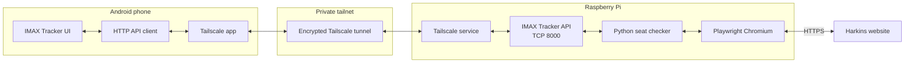
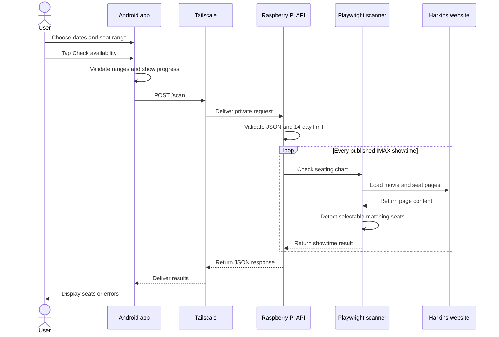

# IMAX Tracker for Android

IMAX Tracker is a native Android application that requests live IMAX seat
availability from a Raspberry Pi. The user chooses a date range, rows, and seat
numbers; the Pi scans published Harkins Arizona Mills IMAX showtimes and returns
the matching seats.

The app checks availability only. It does not reserve seats, add tickets to a
cart, or make purchases.

## Features

- Native Java Android interface
- Configurable Raspberry Pi API address
- Movie and theater summary
- Start and end date selection
- First and last row selection
- First and last seat-number selection
- Live results grouped by date and showtime
- Saved server address and seat preferences
- Background network requests that do not freeze the interface
- Private remote access through Tailscale
- Basic Android Auto companion screen

## Screens and services

```text
IMAXTracker/
├── app/src/main/AndroidManifest.xml
├── app/src/main/java/com/example/helloworld/
│   ├── MainActivity.java
│   └── IMAXSeatTrackerCarAppService.java
├── app/src/main/res/
│   ├── values/strings.xml
│   ├── values/styles.xml
│   └── xml/automotive_app_desc.xml
├── app/build.gradle.kts
├── build.sh
├── gradlew
└── settings.gradle.kts
```

`MainActivity` contains the phone interface and API client.
`IMAXSeatTrackerCarAppService` supplies the current Android Auto summary screen.
Seat selection and scanning are intentionally performed from the phone.

## System architecture



The phone does not scrape the ticketing website itself. It sends a small JSON
request to the Raspberry Pi, and the Pi performs the browser automation. This
keeps Playwright and Chromium off the phone.

## Scan flow



Scans can take several minutes because the Pi opens and inspects each published
showtime. The API processes one scan at a time.

## Requirements and downloads

### Android phone

Required:

- Android phone or tablet
- Android 8.0 or newer for the current Tailscale client
- [Tailscale for Android](https://tailscale.com/docs/install/android)
- The IMAX Tracker APK

The Pi and phone must be signed into the same Tailscale network. No router port
forwarding is required.

### Raspberry Pi backend

The app requires the consolidated companion backend in `RaspPi_Projects`, located at:

```text
/home/pawan/workspace/RaspPi_Projects/IMAX_Seat_Tracker
```

The Pi needs:

- 64-bit Raspberry Pi OS
- Python 3.10 or newer
- Tailscale
- Playwright and its Chromium browser
- The running `api_server.py` service on TCP port `8000`

The configured Pi currently has this Tailscale address:

```text
100.117.156.54
```

The expected API URL is therefore:

```text
http://100.117.156.54:8000
```

### Development computer

Only needed to modify or build the Android application:

- Android Studio, or the Android command-line SDK
- JDK 17
- Android SDK Platform 35
- Git
- This `IMAXTracker` project

Android Gradle Plugin 8.x requires JDK 17. See the official
[Android JDK documentation](https://developer.android.com/build/jdks).

## Verify the Raspberry Pi first

Before installing or testing the Android application, verify that the backend
is running on the Pi:

```bash
systemctl status imax-tracker-api.service
```

Test its local endpoint:

```bash
curl http://127.0.0.1:8000/health
```

Test its Tailscale endpoint:

```bash
curl http://100.117.156.54:8000/health
```

Expected response:

```json
{"status": "ok"}
```

If the service is not installed, start the backend manually:

```bash
cd /home/p-c/Documents/RaspPi_Projects/IMAX_Seat_Tracker
.venv/bin/python api_server.py
```

## Build the Android app

### Existing workspace setup

This workspace includes a local JDK, Android SDK, Gradle wrapper, and build
helper. Run:

```bash
cd /home/pawan/workspace/Android_Apps/IMAXTracker
./build.sh
```

The debug APK is generated at:

```text
app/build/outputs/apk/debug/app-debug.apk
```

### Android Studio

1. Open Android Studio.
2. Select **Open**.
3. Choose the `Android_Apps/IMAXTracker` directory.
4. Allow Gradle synchronization to finish.
5. Select a connected phone or emulator.
6. Choose **Run > Run 'app'**.

For a physical phone, enable Developer options and USB debugging before running
from Android Studio.

### Command line with your own SDK

Set `JAVA_HOME` to JDK 17 and `ANDROID_HOME` to your Android SDK, then run:

```bash
./gradlew :app:assembleDebug
```

On Windows PowerShell:

```powershell
.\gradlew.bat :app:assembleDebug
```

## Install the APK

### Copy and open it

Copy this file to the Android phone:

```text
app/build/outputs/apk/debug/app-debug.apk
```

Open it on the phone and approve the Android prompt to install from that trusted
file source.

### Install with ADB

With USB debugging enabled and the phone connected:

```bash
adb install -r app/build/outputs/apk/debug/app-debug.apk
```

The `-r` option replaces the installed development build while retaining its
application data.

## Connect the phone through Tailscale

1. Install and open Tailscale on the Android phone.
2. Sign in using the same tailnet as the Raspberry Pi.
3. Approve the Android VPN configuration prompt.
4. Confirm the phone shows **Connected**.
5. Confirm the Raspberry Pi appears online with address `100.117.156.54`.
6. Keep Tailscale enabled while using IMAX Tracker.

Tailscale currently supports Android 8.0 and later. See the
[official Android installation guide](https://tailscale.com/docs/install/android).

## Use IMAX Tracker

1. Open **IMAX Tracker**.
2. Confirm the Raspberry Pi API field contains:

   ```text
   http://100.117.156.54:8000
   ```

3. Choose the starting and ending dates.
4. Choose the first and last rows.
5. Choose the first and last seat numbers.
6. Tap **Check availability**.
7. Leave the app open while the Pi scans the published showtimes.

The results card displays:

- The scan date
- The showtime
- Matching available seats
- “No matching seats available” when the selected area is sold out
- A per-showtime error if a seating chart could not be inspected

The app remembers the server URL and selected seat range between launches.

## API contract

The Android app submits:

```http
POST /scan
Content-Type: application/json
```

Example body:

```json
{
  "start_date": "2026-08-30",
  "end_date": "2026-09-05",
  "first_row": "F",
  "last_row": "M",
  "first_seat": 10,
  "last_seat": 25
}
```

Example response:

```json
{
  "results": [
    {
      "date": "2026-09-01",
      "showtime": "11:00 AM",
      "seats": ["F10", "F11", "G12"]
    }
  ]
}
```

The API rejects date ranges longer than 14 days and invalid row or seat ranges.

## Configuration

The default API address is defined in `MainActivity.java`:

```java
"http://100.117.156.54:8000"
```

Users can change the address directly in the app. The new value is saved in
Android `SharedPreferences`.

The application currently permits cleartext HTTP because traffic is carried
inside the encrypted Tailscale tunnel. Do not expose the backend port directly
to the public internet.

## Troubleshooting

### Unable to connect

- Confirm Tailscale is connected on both devices.
- Confirm the Pi appears online in the Tailscale phone app.
- Confirm the API URL includes `http://` and port `8000`.
- On the Pi, run `curl http://100.117.156.54:8000/health`.
- On the Pi, inspect `systemctl status imax-tracker-api.service`.
- Check tailnet grants or ACLs for access to TCP port 8000.
- Disable Android battery optimization for Tailscale if it disconnects in the
  background.

### Scan takes a long time

The Pi checks every matching showtime sequentially. Use a shorter date range to
reduce scan time. The maximum accepted range is 14 days.

### Scan returns no showtimes

- Confirm performances have been published for the selected dates.
- Confirm the configured movie and theater still match the backend.
- Review the backend service logs.
- The Harkins website may have changed its markup.

### Build reports that Java is missing

Install or select JDK 17, then ensure `JAVA_HOME` points to it. Android Studio
can select the Gradle JDK under its Gradle build settings.

### Android blocks APK installation

Open the phone's security settings and temporarily allow installation from the
specific browser or file manager used to open this APK. Do not enable unknown
sources globally when it is unnecessary.

## Current limitations

- Movie and theater selection are currently fixed to The Odyssey at Harkins
  Arizona Mills IMAX.
- The Android Auto screen is informational; scans are started from the phone.
- The API handles one scan at a time.
- The app must remain open during the current synchronous scan request.
- There are no Android unit or instrumentation tests yet.
- The backend depends on third-party website structure and may break when that
  website changes.
- Availability can change after a scan. Confirm seats on the official ticketing
  page before purchasing.

## Privacy and security

- Do not add router port forwarding for port 8000.
- Do not publish SSH keys, passwords, or Tailscale authentication keys.
- Restrict the Pi through Tailscale grants or ACLs if other users share the
  tailnet.
- The backend has no separate application login, so tailnet access is its main
  security boundary.
- Use the checker in accordance with the ticketing website's terms and
  applicable law.
